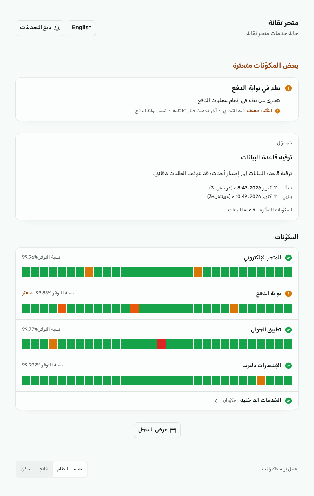

<p align="center">
  <b>العربية</b>
  &nbsp;&nbsp;&nbsp;|&nbsp;&nbsp;&nbsp;
  <a href="README_EN.md">English</a>
</p>

<div dir="rtl">

# راقب

راقب مواقعك وخواديمك وقواعد بياناتك، وانشر صفحة حالة لزوارك. أداة مراقبة تعمل على خادومك، وعربية أولًا.



## التثبيت

على خادوم Linux، أو جهاز Mac بمعالج Apple Silicon، بحساب root:

```sh
curl -fsSL https://raaqeb.dev/install.sh | sudo sh
```

على Windows، في PowerShell يعمل بصفة المسؤول:

```powershell
irm https://raaqeb.dev/install.ps1 | iex
```

أو بـ Docker:

```sh
docker run -d --name raaqeb --restart unless-stopped -p 3000:3000 -v raaqeb-data:/data ghcr.io/taqanah/raaqeb:0.2.2
```

## ما يراقبه

مواقع HTTP ومنافذ TCP وسجلات DNS وقواعد بيانات Postgres وMySQL وRedis وMongoDB وحاويات Docker ونبضات المهام المجدولة وانتهاء صلاحية شهادات TLS وانتهاء تسجيل النطاق. ويستطيع Prometheus وGrafana قراءة حالة كل مراقبة من العنوان `/metrics`، وهو مطفأ حتى تفعّله. وتُطبع تقارير التوفّر خلال شهر أو ربع سنة أو نطاق من الأيام قياسًا إلى هدف توفّر، أو تُنزَّل بصيغة CSV.

ويمكن فحص المراقبة من أكثر من مكان بتشغيل راقب نفسه مسبارًا على خادم آخر، فلا يُفتح الانقطاع إلا حين يتفق عليه العدد الذي تختاره من المواقع.

## الحجم

يعمل على نواة واحدة و240 ميغابايت من الذاكرة، في ملف تنفيذي واحد، ولا يحتاج إلى خدمة خارجية. في آخر قياس تحمّل 800 مراقبة تُفحص كل 20 ثانية وبلغت ذروة الذاكرة 107 ميغابايت، وحجم الملف التنفيذي لنظام Linux نحو 96 ميغابايت.

## المزيد

- [التوثيقات](https://raaqeb.dev/docs)
- [سياسة الأمان](SECURITY.md)
- [المساهمة](CONTRIBUTING.md)
- [الرخصة](LICENSE.md)

</div>
