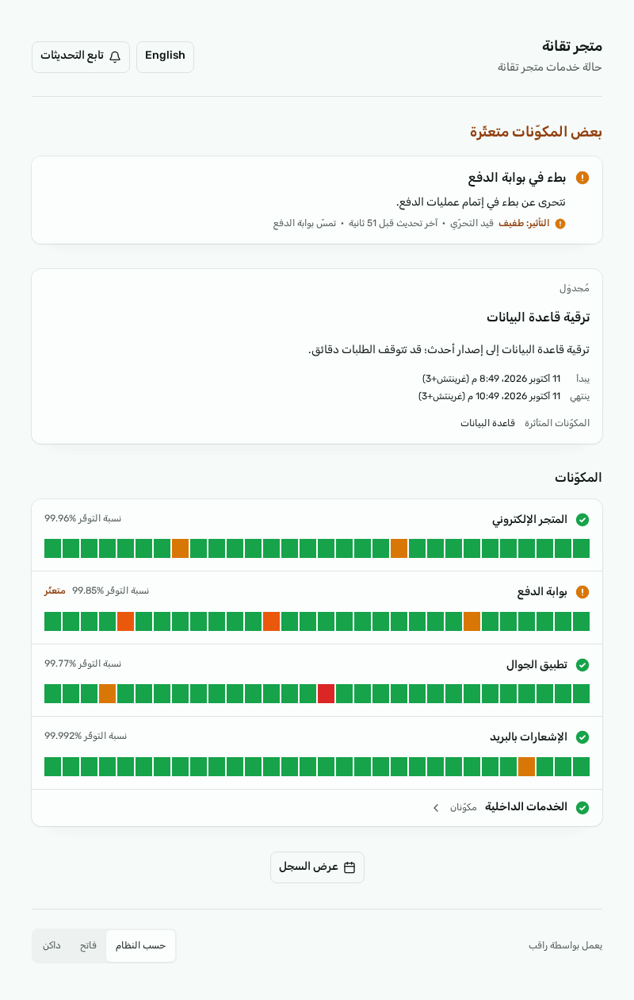

<div dir="rtl">

# راقب

راقب مواقعك وخواديمك وقواعد بياناتك، وانشر صفحة حالة لزوارك. أداة مراقبة تعمل على خادومك، وعربية أولًا.



## التثبيت

على خادوم Linux، أو جهاز Mac بمعالج Apple Silicon، بحساب root:

```sh
curl -fsSL https://raaqeb.dev/install.sh | sudo sh
```

على Windows، في PowerShell يعمل بصفة المسؤول:

```powershell
irm https://raaqeb.dev/install.ps1 | iex
```

أو بـ Docker:

```sh
docker run -d --name raaqeb --restart unless-stopped -p 3000:3000 -v raaqeb-data:/data ghcr.io/taqanah/raaqeb:0.1.0
```

## ما يراقبه

مواقع HTTP ومنافذ TCP وسجلات DNS وقواعد بيانات Postgres وMySQL وRedis وحاويات Docker ونبضات المهام المجدولة وانتهاء صلاحية شهادات TLS.

## الحجم

يعمل على نواة واحدة و240 ميغابايت من الذاكرة، في ملف تنفيذي واحد، ولا يحتاج إلى خدمة خارجية. في آخر قياس تحمّل 800 مراقبة تُفحص كل 20 ثانية وبلغت ذروة الذاكرة 107 ميغابايت، وحجم الملف التنفيذي لنظام Linux نحو 86 ميغابايت.

## المزيد

- [التوثيقات](https://raaqeb.dev/docs)
- [سياسة الأمان](SECURITY.md)
- [المساهمة](CONTRIBUTING.md)
- [الرخصة](LICENSE.md)

</div>

---

# Raaqeb

Raaqeb (راقب, "keep watch") watches your sites, servers and databases and publishes a status page for your visitors. A monitoring tool that runs on your own server, Arabic first.


## Install

On a Linux server, or a Mac with Apple Silicon, as root:

```sh
curl -fsSL https://raaqeb.dev/install.sh | sudo sh
```

On Windows, in PowerShell as Administrator:

```powershell
irm https://raaqeb.dev/install.ps1 | iex
```

Or with Docker:

```sh
docker run -d --name raaqeb --restart unless-stopped -p 3000:3000 -v raaqeb-data:/data ghcr.io/taqanah/raaqeb:0.1.0
```

## What it watches

HTTP sites, TCP ports, DNS records, Postgres, MySQL and Redis databases, Docker containers, the heartbeats of scheduled jobs and TLS certificate expiry.

## Size

It runs on 1 vCPU and 240 MB of RAM as one binary, with no outside service. In the last benchmark it held 800 monitors checked every 20 seconds at a memory peak of 107 MB, and the Linux binary is about 86 MB.

## More

- [Docs](https://raaqeb.dev/en/docs)
- [Security policy](SECURITY.md)
- [Contributing](CONTRIBUTING.md)
- [License](LICENSE.md)
