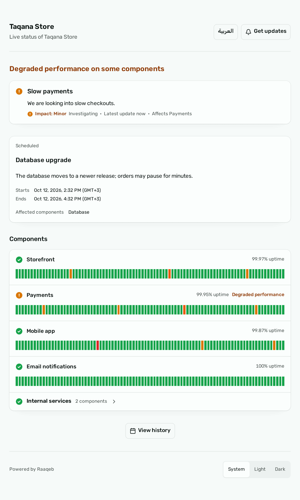

<p align="center">
  <a href="README.md">العربية</a>
  &nbsp;&nbsp;&nbsp;|&nbsp;&nbsp;&nbsp;
  <b>English</b>
</p>

# Raaqeb

Raaqeb (راقب, "keep watch") watches your sites, servers and databases and publishes a status page for your visitors. A monitoring tool that runs on your own server, Arabic first.



## Install

On a Linux server, or a Mac with Apple Silicon, as root:

```sh
curl -fsSL https://raaqeb.dev/install.sh | sudo sh
```

On Windows, in PowerShell as Administrator:

```powershell
irm https://raaqeb.dev/install.ps1 | iex
```

Or with Docker:

```sh
docker run -d --name raaqeb --restart unless-stopped -p 3000:3000 -v raaqeb-data:/data ghcr.io/taqanah/raaqeb:0.2.0
```

## What it watches

HTTP sites, TCP ports, DNS records, Postgres, MySQL, Redis and MongoDB databases, Docker containers, the heartbeats of scheduled jobs, TLS certificate expiry and domain registration expiry. Prometheus and Grafana can read the state of every monitor from an opt-in `/metrics` endpoint. Uptime reports over a month, a quarter or any range of days, against an uptime target, print or download as CSV.

A monitor can be checked from more than one place by running Raaqeb itself as a probe on another server, so an outage opens only when as many locations as you choose agree.

## Size

It runs on 1 vCPU and 240 MB of RAM as one binary, with no outside service. In the last benchmark it held 800 monitors checked every 20 seconds at a memory peak of 107 MB, and the Linux binary is about 96 MB.

## More

- [Docs](https://raaqeb.dev/en/docs)
- [Security policy](SECURITY.md)
- [Contributing](CONTRIBUTING.md)
- [License](LICENSE.md)
